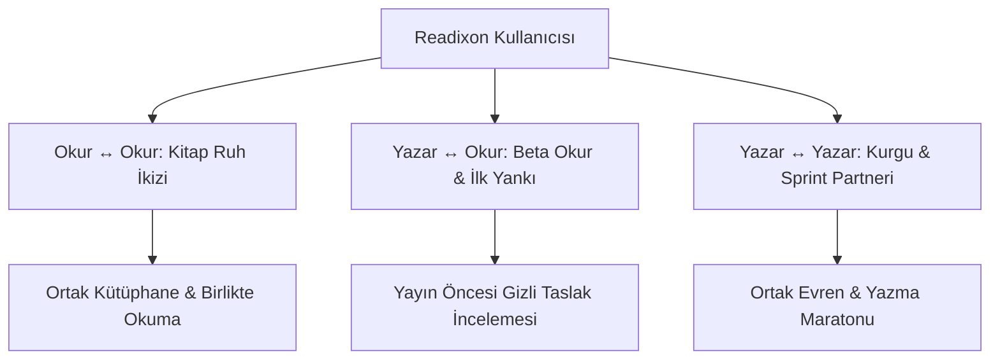
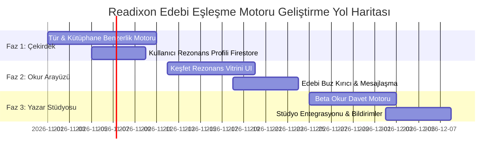

# Readixon Edebi Eşleştirme & Rezonans Motoru Master PRD

**Ürün Kodu:** `READIXON-RESONANCE`  
**Sürüm:** `1.0.0`  
**Durum:** `Gelecek Geliştirme Yol Haritası (Onaylandı / Arşivlendi)`  
**Kapsam:** Çekirdek Algoritma (`@readixon/core`), Kullanıcı Arayüzü (`apps/web`), Mesajlaşma & Sosyal Entegrasyon, Yazar Stüdyosu Beta Okur Paneli, Firestore Şemaları  

---

## 📌 İçindekiler
1. [Yönetici Özeti & Vizyon](#1-yönetici-özeti--vizyon)
2. [Problem Tanımı & Çözüm Formülü](#2-problem-tanımı--çözüm-formülü)
3. [Üç Temel Eşleşme Dikeyi (Personas)](#3-üç-temel-eşleşme-dikeyi-personas)
4. [Matematiksel Eşleşme Algoritması (Edebi Rezonans Skoru)](#4-matematiksel-eşleşme-algoritması-edebi-rezonans-skoru)
5. [Firestore Veri Modelleri & TypeScript Tipleri](#5-firestore-veri-modelleri--typescript-tipleri)
6. [Güvenlik, "Anti-Tinder" Kalkanı & Edebi Filtreler](#6-güvenlik-anti-tinder-kalkanı--edebi-filtreler)
7. [Kullanıcı Deneyimi & UI/UX Akışları](#7-kullanıcı-deneyimi--uiux-akışları)
8. [Yazar Stüdyosu: "İlk Yankı" Beta Okur Çağrısı](#8-yazar-stüdyosu-ilk-yankı-beta-okur-çağrısı)
9. [Aşama Aşama Uygulama Yol Haritası (Fazlar)](#9-aşama-aşama-uygulama-yol-haritası-fazlar)
10. [Başarı Metrikleri (KPIs) & Büyüme Kaldıracı](#10-başarı-metrikleri-kpis--büyüme-kaldıracı)

---

## 1. Yönetici Özeti & Vizyon

**Readixon Rezonans Motoru**, aynı edebi frekanstaki okurları ve yazarları; okuma alışkanlıkları, kitaplıkları, 30 Ana Tür, 393 Alt Tür ve özel trope tercihleri üzerinden yüksek matematiksel isabetle eşleştiren **yeni nesil bir edebi keşif ve topluluk sistemidir.**

### Temel Felsefe:
> *"Kitap okumak ve yazmak doğası gereği yalnız bir eylemdir. Ancak bir kitabın en can alıcı ters köşesinde heyecandan kalbi çarpan bir okur, aynı heyecanı paylaşacak birini arar; saatlerce kurgu üreten bir yazar ise kendi evrenine aşık olacak samimi ilk okuruna ulaşmak ister. Readixon Rezonans, birbirini henüz tanımayan ama aynı kitap ruhunu paylaşan insanları bir araya getiren edebi bir köprüdür."*

Bu sistem bir **tanışma/flört (dating) uygulaması değildir**. Aksine, edebiyatın derinliğini ve saygınlığını koruyarak insanları doğrudan **kitaplar, kurgusal evrenler ve edebi zevkler** etrafında birleştiren entelektüel bir "Kitap Ruh İkizi" ağıdır.

---

## 2. Problem Tanımı & Çözüm Formülü

### Edebiyat Platformlarının Kronik Problemleri:
1. **Okurun Yalnızlığı (Retention / Bağlılık Kaybı):** Okur harika bir kitap bitirir, konuşacak kimsesi olmadığı için uygulamayı kapatır ve günlerce geri dönmez.
2. **Yazarın Sessizlik Çilesi (Cold Audience Trap):** Yeni çıkan yetenekli bir yazar harika bir eser yazar; ancak dev algoritma o eseri kimseye göstermez. Yazar yapıcı eleştiri alamadığı için pes eder.
3. **Yüzeysel Tür Etiketleri:** Standart platformlarda sadece "Fantastik" etiketi vardır; oysa *Karanlık Grimdark* okuru ile *Masalsı Büyü Akademisi* okuru bambaşka kitlelerdir. Birbirlerini bulamazlar.

### Readixon Çözüm Formülü:
| Geleneksel Platform Çıkmazı | Readixon Rezonans Çözümü |
| :--- | :--- |
| Yalnız ve pasif okuma | Ortak zevke sahip okurlarla anında rezonans kurma ve birlikte okuma. |
| Yazarın görünmezlik duvarı | Yazarın yazdığı alt türe (%90+) aşık olan okurlara doğrudan "Beta Okur Çağrısı" gönderebilmesi. |
| Yüzeysel tür filtreleri | **30 Ana Tür + 393 Alt Tür + Yazar Özel Trope'ları** ile milimetrik edebi DNA eşleşmesi. |
| Yozlaşmış sosyal medya flörtleşmesi | Tamamen edebi içerik, alıntılar ve kitap sohbetleriyle sınırlandırılmış "Anti-Tinder Edebi Kalkanı". |

---

## 3. Üç Temel Eşleşme Dikeyi (Personas)



### 1. Dikey: Okur ↔ Okur ("Kitap Ruh İkizleri / Book Soulmates")
* **Hedef:** Aynı türün aynı alt dalına tutkuyla bağlı iki okuru buluşturmak.
* **Örnek Senaryo:** Aylin ve Murat ikisi de *"Bilim Kurgu -> Distopya"* ve *"Zaman Döngüsü"* alt türlerini favorilerine eklemiş, kitaplıklarında aynı 3 kitabı bulunduruyor. Sistem ikisine de `%94 Edebi Rezonans` kartı önerir.
* **Aksiyon:** Tek tıkla *"Edebi Selamlaşma"* gönderme, *"Birlikte Okuma Kulübü"* kurma veya kitap takası/önerisi yapma.

### 2. Dikey: Yazar ↔ Okur ("Beta Okur & İlk Yankı")
* **Hedef:** Yazarın taslak veya yeni yayınlanan bölümünü, o türü en çok tüketen sadık okurlarla buluşturmak.
* **Örnek Senaryo:** Yazar Burak, *"Grimdark + Askerî Fantastik"* türünde yeni bir bölüm yazdı. Platformdaki okurları tarar ve bu türe puanı en yüksek 5 okura özel davet kartı üretir: *"Burak, yeni kurgusu için senin edebi gözüne güveniyor."*
* **Değer:** Yazar anında yapıcı ilk geri bildirimi (beta feedback) alır; okur ise henüz kimsenin görmediği bir esere önceden erişip adını "Özel Teşekkür" listesine yazdırır.

### 3. Dikey: Yazar ↔ Yazar ("Kurgu Partneri & Yazı Kampı")
* **Hedef:** Birbirine rakip değil, edebi yoldaş olacak yazarları eşleştirmek.
* **Örnek Senaryo:** İki bağımsız fantastik yazarı bir araya gelerek ortak evren (Shared Universe) inşa edebilir, haftalık yazma hedefleri (Sprint / Arena) belirleyebilir.

---

## 4. Matematiksel Eşleşme Algoritması (Edebi Rezonans Skoru)

Eşleştirme motoru her kullanıcı çifti $(U_A, U_B)$ için 0 ile 100 arasında bir **Rezonans Skoru ($R_{score}$)** hesaplar:

$$R_{score} = (S_{main} \times 0.20) + (S_{sub} \times 0.40) + (S_{tropes} \times 0.15) + (S_{library} \times 0.25)$$

### Katsayı Açıklamaları:
1. **$S_{main}$ (Ana Tür Kesişimi - %20):**
   * Kullanıcıların `preferredGenres` listesindeki 30 Ana Türün Jaccard Benzerliği:
     $$J(A, B) = \frac{|A \cap B|}{|A \cup B|}$$
2. **$S_{sub}$ (Resmi Alt Tür Kesişimi - %40 - En Kritik Bileşen):**
   * İki kullanıcının da tercih ettiği 393 alt tür arasındaki kesişim. *"Büyü Akademisi"*, *"Siberpunk"*, *"Düşmandan Aşığa"* gibi spesifik zevkler edebi uyumun ana kalbidir.
3. **$S_{tropes}$ (Özel Yazar Trope'ları Kesişimi - %15):**
   * Yazarların ve okurların etiketlediği serbest alt türler (örn: *LitRPG, Cozy Fantasy, Slow-Burn*).
4. **$S_{library}$ (Kitaplık & Beğeni Kesişimi - %25):**
   * Ortak kütüphaneye eklenen (`savedStories`), okunan (`readingProgress`) ve beğenilen (`likes`) hikayelerin kesişim katsayısı.

> **Eşik Değer (Threshold):** Yalnızca $R_{score} \ge 70$ olan adaylar kullanıcılara "Edebi Rezonans / Ruh İkizi" olarak sunulur.

---

## 5. Firestore Veri Modelleri & TypeScript Tipleri

### 1. Kullanıcı Rezonans Profili (`UserResonanceProfile`)
Her kullanıcının hızlı taranması için derlenmiş edebi DNA belgesi:
```typescript
// packages/core/src/types/resonance.ts

export interface UserResonanceProfile {
  userId: string;
  username: string;
  displayName: string;
  avatarUrl?: string;
  isAuthor: boolean;
  
  // Edebi Tercih Vektörleri
  primaryGenres: string[];     // En çok okunan/yazılan ana türler (maks 3)
  topSubGenres: string[];      // En sevilen alt türler (maks 10)
  favoriteTropes: string[];    // Serbest etiketler (maks 10)
  
  // Kütüphane Özeti
  libraryStoryIds: string[];   // Kaydedilen ve okunan eser ID'leri (maks son 50)
  likedAuthorIds: string[];    // Takip edilen favori yazarlar
  
  // Tercihler & Güvenlik
  optInMatching: boolean;      // Eşleşmeye açık mı? (Varsayılan: true)
  allowBetaReaderRequests: boolean; // Beta okur daveti almak istiyor mu?
  updatedAt: Timestamp;
}
```

### 2. Rezonans Eşleşme Kaydı (`ResonanceMatch`)
```typescript
export interface ResonanceMatch {
  id: string;
  userAId: string;
  userBId: string;
  resonanceScore: number;       // örn: 94 (%94 Uyum)
  
  commonMainGenres: string[];   // Ortak ana türler
  commonSubGenres: string[];    // Ortak alt türler
  commonStories: {              // Ortak sevdikleri kitaplar
    storyId: string;
    title: string;
    coverImage?: string;
  }[];
  
  status: 'suggested' | 'greeted' | 'connected' | 'dismissed';
  lastInteractionAt?: Timestamp;
  createdAt: Timestamp;
}
```

### 3. Beta Okur Daveti (`BetaReaderInvitation`)
```typescript
export interface BetaReaderInvitation {
  id: string;
  authorId: string;
  authorName: string;
  readerId: string;
  storyId: string;
  storyTitle: string;
  chapterId?: string;           // Henüz yayınlanmamış taslak bölüm
  chapterTitle?: string;
  pitchMessage: string;         // Yazarın okura özel edebi notu
  status: 'pending' | 'accepted' | 'declined' | 'completed';
  createdAt: Timestamp;
  expiresAt: Timestamp;         // 7 gün geçerli
}
```

---

## 6. Güvenlik, "Anti-Tinder" Kalkanı & Edebi Filtreler

Sistemin flört veya arkadaşlık sitesine dönmesini engellemek için **sert edebi sınırlar** konulmalıdır:

1. **Görsel Odak Değil, Edebi Kimlik:**
   * Eşleşme kartlarında büyük boy profil fotoğrafları veya yaş/konum bilgisi yer almaz.
   * Vitrinde yazarın/okurun **"Kitaplığı, Favori Alıntıları ve Tür Ağacı"** devasa puntolarla sergilenir.
2. **Serbest DM Değil, "Edebi Buz Kırıcılar" (Icebreakers):**
   * Eşleşen kullanıcılar ilk temasta rastgele *"Selam naber"* yazamaz.
   * Sistem otomatik 4 hazır edebi soru sunar:
     * 📖 *"Sisler Şehri'nin final sahnesi hakkında ne düşünüyorsun?"*
     * 🧙‍♂️ *"Senin favori Grimdark eserin hangisi?"*
     * ✍️ *"Şu an üzerinde çalıştığım büyülü realizm kurgusunun taslağına göz atmak ister misin?"*
3. **Tek Tıkla Gizlilik & Engelleme:**
   * Dileyen kullanıcı profil ayarlarından `Edebi Eşleşmeyi Kapat` anahtarını tek tıkla kapatabilir.
   * Uygunsuz mesaj anında moderasyona raporlanır; taciz eden kullanıcı platformdan kalıcı uzaklaştırılır.

---

## 7. Kullanıcı Deneyimi & UI/UX Akışları

```
[Keşfet / Vitrin] ──> "Edebi Pusula (Rezonans)" Kartı
         │
         ├──> [Kitap Ruh İkizleri Vitrini] (%92 Uyumlu Okurlar)
         │           │
         │           ├──> "Kitaplığını İncele"
         │           └──> "Edebi Buz Kırıcı Gönder" ──> (/messages Entegrasyonu)
         │
         └──> [Stüdyo: Beta Okur Havuzu] (Yazar İçin)
                     │
                     └──> "Taslağımı Bu Türün Tutkunlarına Gönder" (3 Davet)
```

### Ekran Detayları:
1. **Keşfet Sekmesinde `Edebi Rezonans` Modülü:**
   * Aurora parıltılı, yıldız haritası tarzı lüks tasarım.
   * *"Seninle aynı edebi evrende yaşayan okurlar keşfedildi."*
2. **Kişisel Eşleşme Kartı:**
   * Kullanıcı adı ve rozeti.
   * **Rezonans Rozeti:** `%91 Edebi Frekans`.
   * **Ortak Zevkler Çipi:** 👑 *Fantastik* + 🗡️ *Kılıç ve Büyü* + 📜 *Antik Mitoloji*.
   * **Ortak Eser:** *"İkiniz de 'Gece Krallığı' eserini kitaplığınıza eklediniz."*
   * **Aksiyon:** `[ Edebi Selam Gönder ]` `[ Kitaplığı Gör ]`.

---

## 8. Yazar Stüdyosu: "İlk Yankı" Beta Okur Çağrısı

Yazarlar için en devrimsel özellik:

1. Yazar `/studio/story/[storyId]/chapter/[chapterId]` sayfasında bölümünü yazar.
2. Sağ üst köşedeki **"İlk Yankı: Beta Okur Bul"** butonuna basar.
3. Algoritma arka planda çalışarak şu kriterleri karşılayan 3 aktif okuru bulur:
   * Eserin ana türü ve alt türleriyle %85+ uyumlu olan,
   * Son 7 günde aktif kitap okuyan,
   * Daha önce yapıcı yorum/inceleme yazmış olan.
4. Okura özel bildirim gider:
   > *"🌌 Yazar Can, 'Kayıp Çağlar' adlı yeni taslağını ilk senin okumanı ve edebi fikrini almayı çok istiyor!"*
5. Okur kabul ettiğinde taslağı okur, satır aralarına özel notlar bırakır.

---

## 9. Aşama Aşama Uygulama Yol Haritası (Fazlar)



### Faz 1: Çekirdek Matematik Motoru & Veri Hazırlığı
* `@readixon/core` içine `calculateResonanceScore(userA, userB)` fonksiyonunun yazılması.
* Kullanıcı profillerine `preferredGenres` dışında okunan kitaplardan türetilen alt tür vektörlerinin eklenmesi.
* Basit eşleşme indekslerinin Firestore'da oluşturulması.

### Faz 2: Kamusal Vitrin & Sosyal Buz Kırıcılar
* `/explore` ve `/profile/[username]` sayfalarına "Edebi Ruh İkizleri" kartlarının yerleştirilmesi.
* Edebi buz kırıcılar üzerinden `/messages` altyapısına doğrudan güvenli sohbet bağlama.
* Kullanıcı gizlilik kontrolleri (`optInMatching`).

### Faz 3: Stüdyo "İlk Yankı" Beta Okur Sistemi
* Yazar Stüdyosu bölüm editörüne "Beta Okur Çağrısı" modalı eklenmesi.
* Okuyucuya özel gizli taslak okuma arayüzü ve geri bildirim formu.
* Okurun profilinde *"Resmi Beta Okur"* rozeti kazanması.

---

## 10. Başarı Metrikleri (KPIs) & Büyüme Kaldıracı

Bu özellik hayata geçtiğinde takip edilecek kritik göstergeler:
* **Geri Dönüş Oranı (D7 / D30 Retention):** Edebi eşleşme yapan kullanıcıların 30 günlük elde tutulma oranında **%40+ artış** hedeflenir.
* **Yazar Devamlılığı (Author Churn Drop):** İlk 3 bölümünü yazıp bırakan yazarların en az 1 beta okurla eşleşmesi durumunda yazmaya devam etme oranının **3 katına** çıkması.
* **Organik Mesajlaşma Hacmi:** Sistemdeki mesajlaşma trafiğinde kitap odaklı etkileşimlerin %150 artması.

---

*Bu belge, Readixon platformunun gelecekteki en büyük sosyal ve edebi dönüşüm adımı olarak uygulanmak üzere hazırlanmış ve onaylanmıştır.*
