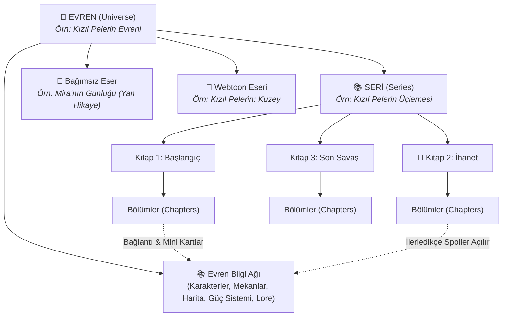

# Readixon Evren Stüdyosu & Seri Kitap Bütünleşik Mimari Analizi

Bu doküman, **READIXON_EVREN_STUDYOSU_MASTER_PRD.md** (82 bölüm, 2589 satır) ile **Seri Kitap Özelliği (seri_kitap_ozelligi.md)** arasındaki mutlak uyumu, mevcut Readixon kod tabanıyla entegrasyonunu ve teknik/ürünsel yol haritasını detaylandırır.

---

## 1. 🌌 Büyük Resim: Readixon Kurgu Hiyerarşisi

Yapılan derinlemesine analiz göstermektedir ki, **"Seri Kitap Özelliği"** ve **"Evren Stüdyosu"** ayrı iki proje değil, aynı yapının iki temel dişlisidir:



* **Evren (Universe):** En üst çatıdır. Karakterler, mekânlar, güç sistemleri, mitoloji ve harita buraya aittir.
* **Seri (Series):** Evren içinde geçen, sıralı devam kitaplarının (Kitap 1, 2, 3) oluşturduğu omurgadır.
* **Eser (Story - Roman veya Webtoon):** Tekil kitaptır. Bir seriye bağlı olabilir veya evren içinde bağımsız bir spin-off / webtoon olabilir.
* **Bölüm (Chapter):** İçinde karakterlerin, mekânların ve terimlerin geçtiği, okuyucunun ilerleme kaydettiği yapı taşıdır.

---

## 2. 📋 Master PRD'nin 82 Bölümünün Derin Analizi & Çekirdek Çıkarımları

Master PRD, Readixon'u klasik bir yayın platformundan **"Yazarlık İşletim Sistemi + Yaşayan Hikaye Evreni"**ne dönüştürmeyi hedefler. Dokümandan çıkarılan kritik temalar:

### 2.1. Temel Felsefe (Bölüm 1 - 5)
1. **Asistanın Rolü:** AI yazarın yerine roman yazmaz; yazarın kurduğu dünyayı unutmasını engeller, tutarsızlıkları yakalar (ör. *"Bölüm 4'te gözü maviydi, Bölüm 18'de kahverengi yazdın"*).
2. **Yaşayan Ağ:** Karakter tek başına bir form değildir; bir mekâna, bir aileye, bir güç sistemine ve belirli bölümlere bağlıdır.
3. **İki Yüzlü Deneyim:** 
   * **Yazar Yüzü (Evren Defteri):** Spoiler dolu, derin, iceberg'in su altındaki katmanı.
   * **Okur Yüzü (Evrene Gir):** Görsel, şık, spoiler kontrollü, keşif hissi veren vitrin.
4. **Çoklu Format:** Bir evrende aynı anda Roman, Webtoon, Yan Hikaye ve Prequel yaşayabilir.

### 2.2. Bilgi Mimarisi ve Modüller (Bölüm 6 - 31)
PRD 24 temel bilgi modülü tanımlar:
* **Karakter Defteri 2.0:** Temel Dosya, Fiziksel Profil, Psikolojik Analiz, Karakter Eğrisi (8 aşamalı), Yetkinlik Puanları, İlişki Ağları, Bölüm Geçmişi ve PNG Vitrini.
* **Mekân Defteri & Dünya Haritası:** Evren/Kıta/Şehir/Bina hiyerarşisi. Yazar harita görseli yükleyip interaktif pinler, rotalar koyabilir. Okur için sisli/keşfedilmemiş harita desteği.
* **Olaylar & Çift Zaman Çizelgesi (Timeline):** "Evren Tarihi" (Dünyanın büyük tarihi) vs "Hikaye Zaman Çizelgesi" (Kitaptaki kronoloji). Kurmaca takvim (örn. *"Mühürden Sonra 12"*).
* **Dünya Kurma Unsurları:** Organizasyonlar, Hanedanlar/Soyağacı, Eşyalar/Artefaktlar, Irklar/Yaratıklar, Güç/Büyü/Teknoloji Sistemleri, Kültür, Din/Mitoloji, Siyaset, Ekonomi, Diller ve Sözlük.
* **Iceberg Modeli & Seri Bible:** Yazar Notu vs Okuyucu Açıklaması vs Gizli Gerçek ayrımı. Uzun seriler için "Açık ve Çözülen Gizemler" takibi.

### 2.3. Mevcut Readixon Araçlarıyla Entegrasyon (Bölüm 32 - 35, 53, 54)
* **Kurgu Sihirbazı (A/B/C/D):** A (Temel Dünya/Karakter), B (Bölüm Kurgu Planı - en kritik köprü!), C (Derinlik), D (Kitaplar arası mimari).
* **Bölüm Editörü (Studio):** Yazar yazarken yan panelde o bölümdeki karakterleri, mekânları, eşyaları görür; metinden tek tıkla evren öğesine bağlar.
* **Yazar Akademisi:** Akademi dersi bittiğinde ("Güç Sistemi Nasıl Kurulur?"), yazar doğrudan Evren Stüdyosu'ndaki ilgili modüle yönlendirilir.
* **Editoryal İnceleme:** Editörler eseri değerlendirirken yazarın evren derinliğini referans alabilir.

### 2.4. Güvenlik, Gizlilik ve Spoiler Motoru (Bölüm 36 - 38, 78)
* Bilgiler: `Özel`, `Ekip`, `Taslak`, `Kısmen Açık`, `Herkese Açık`.
* Spoiler Koşulu: *"Bölüm X'ten sonra aç"*, *"Kitap X bittikten sonra aç"*, *"Sadece Yazar"*.
* Dinamik Filtreleme: Okur Bölüm 7'deyse karakterin gerçek kimliği gizlidir; Bölüm 20'yi bitirdiğinde açılır ("Keşfedildi!" hissi).

### 2.5. Tasarım Dili ve Öncelikler (Bölüm 47 - 52, 69, 79)
* **P0 (Omurga):** Evren, Çoklu Eser Bağlantısı, Karakter Defteri 2.0, Mekân, Olay/Timeline, Organizasyon, Lore, Sözlük, Görünürlük/Spoiler, Okuyucu "Evrene Gir", Bölüm Bağlantıları, Mini Kartlar.
* **P1 (Farklılaştırıcılar):** Dünya Haritası, İlişki Haritası (Graph), Soyağacı, Güç Sistemi, Seri Bible, Açık Konular, Kurgu Sihirbazı Entegrasyonu, AI Tutarlılık.
* **P2 (Görsel Zirve):** PNG Parallax Vitrini, 3D Kart Hissi, Keşif Rotaları, Sosyal Paylaşım Kartları, Gelişmiş İstatistikler.

---

## 3. 🧩 Seri Kitap ile Evren Stüdyosu Entegrasyon Modeli

Seri Kitap planımız ile Evren Stüdyosu PRD'si birleştiğinde veri tabanı mimarisi mükemmel bir sadeliğe kavuşur:

### 3.1. Firestore Koleksiyon Hiyerarşisi

```text
/universes/{universeId}                     --> Evren ana dokümanı
   ├── /characters/{characterId}            --> Evren karakterleri (Karakter Defteri 2.0)
   ├── /locations/{locationId}              --> Evren mekânları
   ├── /events/{eventId}                    --> Zaman çizelgesi olayları
   ├── /organizations/{organizationId}      --> Organizasyonlar & Aileler
   ├── /items/{itemId}                      --> Eşyalar & Artefaktlar
   ├── /powerSystems/{systemId}             --> Güç sistemleri
   ├── /glossary/{termId}                   --> Evren sözlüğü
   └── /lore/{loreId}                       --> Lore kayıtları

/series/{seriesId}                          --> Seri dokümanı (universeId referansı içerir)
   └── books: [{ storyId, order, label }]

/stories/{storyId}                          --> Mevcut Eser dokümanı
   ├── universeId?: string                  --> Hangi evrene bağlı olduğu
   ├── seriesId?: string                    --> Hangi seriye bağlı olduğu
   ├── seriesOrder?: number                 --> Serideki sırası (Kitap 1, 2...)
   └── /chapters/{chapterId}
```

### 3.2. Çapraz Faydalar
1. **Tekrarı Önleme:** Yazar aynı karakteri (örn. Boris) Kitap 1, Kitap 2 ve Webtoon için 3 defa oluşturmaz. Karakter **Evren** düzeyindedir; Kitap 1'in Bölüm 3'üne ve Kitap 2'nin Bölüm 1'ine bağlanır.
2. **Evren Sayesinde Seri Bütünlüğü:** Seri Bible doğrudan bu veriden beslenir. Yazar Kitap 3'ü yazarken Kitap 1'deki bir olayı veya nesneyi tek tıkla hatırlar.
3. **Okur Sadakati:** Okur sadece bir kitabı değil, tüm bir evreni (ve o evrendeki seriyi) takip eder.

---

## 4. 🛠️ Mevcut Kod Tabanı ile Bütünleşme Noktaları

| Modül | Mevcut Kod | Yeni Entegrasyon |
| :--- | :--- | :--- |
| **Karakterler** | `packages/core/src/services/characterService.ts` & `Character` tipi | Mevcut `storyId` tabanlı karakterler geriye dönük uyumlu tutulur; yeni sistemde `universeId` eklenerek Karakter Defteri 2.0'a genişletilir. |
| **Kurgu Sihirbazı** | `packages/core/src/types/planner.ts` & `studio/story/[storyId]/planner` | Modül A, B, C, D çıktıları Evren Defteri'ne bağlanır. Özellikle B modülü bölüm içi evren elemanlarıyla eşleşir. |
| **Studio Dashboard** | `apps/web/src/app/studio/page.tsx` | Üst sekmelere "Evrenlerim" ve "Serilerim" eklenir. |
| **Bölüm Editörü** | `apps/web/src/app/studio/story/[storyId]/chapter/[chapterId]/page.tsx` | Yan çekmeceye (drawer) "Evren Paneli" eklenir (o bölümdeki karakterler, mekânlar, terimler). |
| **Kitap Detayı** | `apps/web/src/app/(main)/story/[slug]/page.tsx` | "Serinin Diğer Kitapları" şeridi + "Evrene Gir" çağrı butonu. |
| **Okuma Ekranı** | `apps/web/src/app/read/[storyId]/[chapterId]/page.tsx` | Metin içi kelimeye dokununca açılan bottom-sheet / popover sözlük & karakter mini kartı. |
| **Küratör / Editör** | `apps/web/src/app/editor/page.tsx` | Serileri ve Evrenleri bütüncül vitrine taşıma (Hero afişi ve Editoryal Rozetler). |
| **Admin Paneli** | `apps/web/src/app/admin/` | `/admin/universes` ve `/admin/series` yönetim ekranları. |

---

## 5. 🚀 Önerilen Faz Planı (P0'dan Başlayarak)

Master PRD'deki 70. kurala sadık kalarak ("MVP değil, ürün omurgası"):

* **Adım 1 (Çekirdek Veri & Modeller):** `@readixon/core` içinde `Universe`, `Series`, `Character2.0`, `Location`, `TimelineEvent` şemalarını ve temel servislerini kurmak.
* **Adım 2 (Studio - Evren & Seri Oluşturma):** Yazarın Studio'da bir Evren oluşturabilmesi, var olan kitaplarını ve yeni serilerini bu evrene bağlayabilmesi.
* **Adım 3 (Karakter & Mekan Ağları):** Karakter Defteri 2.0 (ilişkiler, psikoloji, PNG vitrini) ve Mekanlar modülü.
* **Adım 4 (Okur Deneyimi - Evrene Gir & Seri Şeridi):** Kitap detayında seri şeridi ve "Evrene Gir" portalı. Okuma ekranında spoiler-korumalı mini kartlar.
* **Adım 5 (İleri Özellikler - Harita, Timeline, AI):** İnteraktif harita pini, çift timeline ve AI tutarlılık asistanı.
